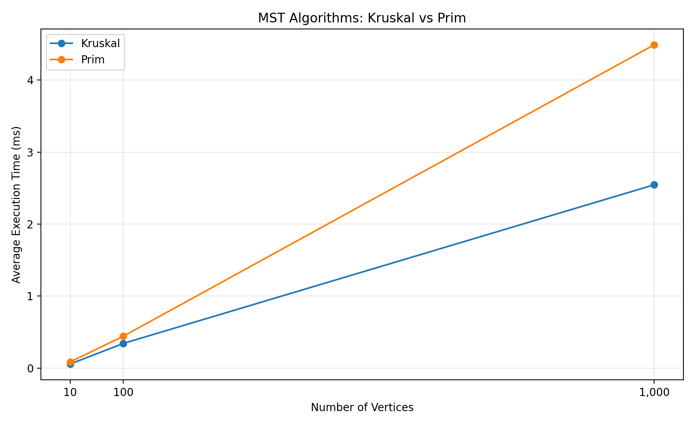
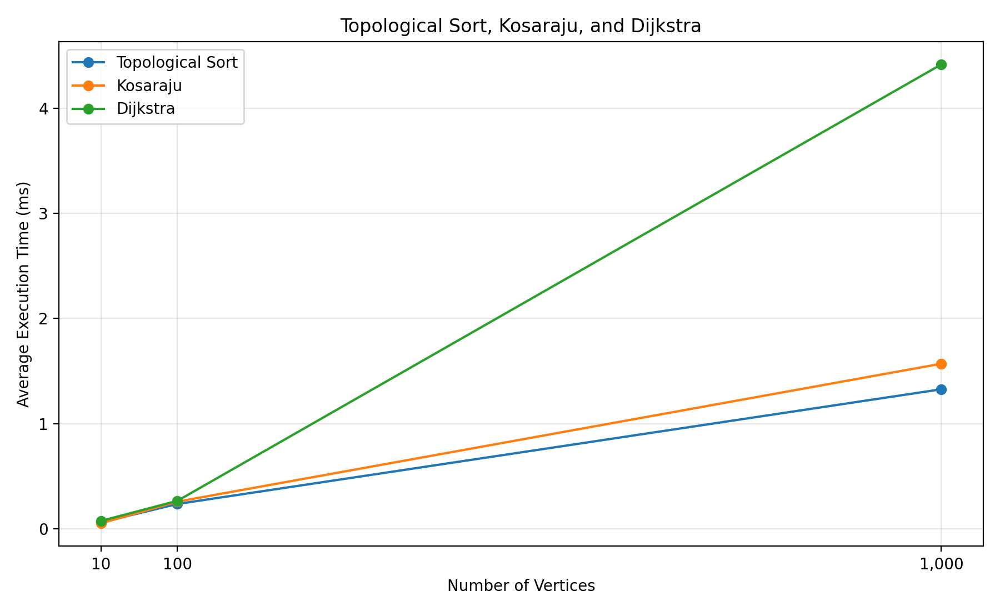

# Smart City Infrastructure and Route Planning

## 1. Project Overview

**Project Name:** Smart City Infrastructure and Route Planning  
**Project Type:** Algorithms and Data Structures  
**Programming Language:** Java  
**Build Tool:** Apache Maven  
**Java Version:** 17

### Description

This project implements and evaluates graph algorithms used in smart city infrastructure planning and route optimization. A city can be represented as a graph in which vertices represent locations, such as residential areas, hospitals, universities, and airports, while edges represent roads or connections between these locations.

The project implements algorithms for finding minimum spanning trees, determining topological order, identifying strongly connected components, and calculating shortest paths.

The main goal is to understand how different graph algorithms work, analyze their time complexity, test their correctness, and compare their execution times on graphs of different sizes.

## 2. Project Objectives

The objectives of this project are:

- Implement graph data structures using Java.
- Implement the Disjoint Set Union (DSU) data structure.
- Find minimum spanning trees using Kruskal's and Prim's algorithms.
- Perform topological sorting on directed acyclic graphs.
- Find strongly connected components using Kosaraju's algorithm.
- Calculate shortest paths using Dijkstra's algorithm.
- Test algorithm correctness using automated unit tests.
- Benchmark algorithms on graphs containing 10, 100, and 1,000 vertices.
- Analyze experimental results and compare them with theoretical time complexities.

## 3. Technologies Used

| Technology | Purpose |
|---|---|
| Java 17 | Implementing algorithms |
| Apache Maven | Project configuration and build management |
| JUnit 5 | Automated unit testing |
| IntelliJ IDEA | Development environment |
| Git and GitHub | Version control and project hosting |
| CSV | Storing benchmark results |
| Python / Matplotlib | Generating benchmark graphs |

## 4. Project Structure

```text
DAA_3/
├── .gitignore
├── pom.xml
├── README.md
├── results/
│   ├── benchmark-day4.txt
│   ├── benchmark-results.csv
│   ├── mst-comparison.png
│   └── other-algorithms.png
└── src/
    ├── main/
    │   └── java/
    │       └── smartcity/
    │           ├── Main.java
    │           ├── graph/
    │           │   ├── Edge.java
    │           │   ├── Graph.java
    │           │   └── DirectedGraph.java
    │           ├── dsu/
    │           │   └── DSU.java
    │           ├── mst/
    │           │   ├── MSTResult.java
    │           │   ├── Kruskal.java
    │           │   └── Prim.java
    │           ├── connectivity/
    │           │   ├── TopologicalSort.java
    │           │   └── Kosaraju.java
    │           ├── shortestpath/
    │           │   └── Dijkstra.java
    │           └── benchmark/
    │               └── Benchmark.java
    └── test/
        └── java/
            └── smartcity/
                └── AlgorithmTests.java
```

## 5. Graph Representation

The project uses two graph representations.

### Undirected Weighted Graph

An undirected weighted graph represents two-way connections between city locations. Each edge has a weight, which can represent distance, construction cost, or another numerical measure.

The graph is used by Kruskal's and Prim's algorithms to find a minimum spanning tree.

### Directed Graph

A directed graph represents one-way relationships between locations or infrastructure dependencies. The direction of an edge determines which vertex can be reached from another vertex through that edge.

The directed graph is used by topological sorting, Kosaraju's algorithm, and Dijkstra's algorithm.

## 6. Implemented Algorithms

### 6.1. Disjoint Set Union (DSU)

DSU maintains a collection of disjoint sets. It supports two main operations:

- **Find:** Determines the representative of the set containing an element.
- **Union:** Combines two sets into one set.

The implementation uses path compression and union by size or rank, depending on the implementation.

DSU is used by Kruskal's algorithm to detect whether adding an edge would create a cycle.

**Time complexity:** Nearly constant amortized time per operation, \(O(\alpha(V))\), when path compression and union by rank or size are used.

### 6.2. Kruskal's Algorithm

Kruskal's algorithm finds a minimum spanning tree of a connected, undirected, weighted graph.

The algorithm:

1. Sorts all edges by increasing weight.
2. Starts with an empty spanning tree.
3. Considers edges in sorted order.
4. Uses DSU to check whether an edge connects two different components.
5. Adds the edge if it does not create a cycle.
6. Stops when the spanning tree contains \(V-1\) edges or all edges have been processed.

A minimum spanning tree connects all vertices with the minimum possible total edge weight.

**Time complexity:** \(O(E\log E)\), dominated by sorting the edges.

### 6.3. Prim's Algorithm

Prim's algorithm also finds a minimum spanning tree of a connected, undirected, weighted graph.

The algorithm:

1. Selects a starting vertex.
2. Adds the starting vertex to the visited set.
3. Considers edges connecting visited vertices to unvisited vertices.
4. Selects the minimum-weight eligible edge.
5. Adds the new vertex and edge to the tree.
6. Repeats until all vertices are included or no eligible edges remain.

**Time complexity:** Typically \(O((V+E)\log V)\) with an adjacency list and a binary heap priority queue.

### 6.4. Topological Sort

Topological sorting produces a linear ordering of vertices in a directed acyclic graph (DAG).

If an edge \(u \rightarrow v\) exists, vertex \(u\) must appear before vertex \(v\) in the ordering.

The implementation uses Kahn's algorithm:

1. Calculates the in-degree of each vertex.
2. Adds all vertices with in-degree zero to a queue.
3. Removes a vertex from the queue and adds it to the ordering.
4. Decreases the in-degree of its outgoing neighbors.
5. Adds any neighbor whose in-degree becomes zero.
6. Checks whether all vertices were processed.

If not all vertices can be processed, the graph contains a directed cycle and has no topological ordering.

**Time complexity:** \(O(V+E)\).

### 6.5. Kosaraju's Algorithm

Kosaraju's algorithm identifies strongly connected components (SCCs) in a directed graph.

A strongly connected component is a maximal group of vertices in which every vertex is reachable from every other vertex in the group.

The algorithm:

1. Performs a depth-first search (DFS) on the original graph.
2. Records vertices in finishing-time order.
3. Reverses all edges to create the transpose graph.
4. Processes vertices in decreasing finishing-time order on the transpose graph.
5. Each DFS traversal identifies one strongly connected component.

**Time complexity:** \(O(V+E)\).

### 6.6. Dijkstra's Algorithm

Dijkstra's algorithm calculates shortest-path distances from a source vertex to other vertices in a weighted graph with non-negative edge weights.

The algorithm:

1. Initializes the source distance to zero and all other distances to infinity.
2. Uses a priority queue to process the vertex with the smallest known distance.
3. Examines the outgoing edges of the current vertex.
4. Updates a neighbor's distance if a shorter route is found.
5. Continues until the priority queue is empty or the implementation's stopping condition is reached.

The algorithm can also store predecessor information to reconstruct the shortest path.

**Time complexity:** Typically \(O((V+E)\log V)\) with an adjacency list and a binary heap priority queue.

**Limitation:** Dijkstra's algorithm does not support negative edge weights.

## 7. Testing

Automated unit tests are implemented using JUnit 5.

The test suite covers the following areas:

- DSU operations and set merging.
- Minimum spanning tree results from Kruskal's algorithm.
- Minimum spanning tree results from Prim's algorithm.
- Topological sorting of a directed acyclic graph.
- Detection of directed cycles during topological sorting.
- Strongly connected component identification.
- Shortest-path calculation using Dijkstra's algorithm.
- Handling of unreachable vertices.

The tests help verify that the algorithms produce expected results for representative graph inputs.

### Running the Tests

In IntelliJ IDEA:

1. Open the project.
2. Wait for Maven to finish importing dependencies.
3. Open `src/test/java/smartcity/AlgorithmTests.java`.
4. Click the green Run icon next to the test class.
5. Check the test results in the Run window.

Alternatively, if Maven is installed and configured in the terminal, execute:

```bash
mvn clean test
```

A successful run should report that the tests passed. The exact number of passing tests depends on the current contents of `AlgorithmTests.java`.

## 8. Benchmark Methodology

The benchmark evaluates the implemented algorithms on graphs of three sizes:

- 10 vertices.
- 100 vertices.
- 1,000 vertices.

The benchmark uses generated graphs and measures the average execution time of each algorithm.

### Measurement Procedure

1. Generate the required graph.
2. Perform one warm-up run.
3. Execute five timed runs for each algorithm.
4. Calculate the average execution time.
5. Record the measurements in milliseconds.
6. Compare results across different graph sizes.

The measurements were collected in the development environment using Java and the project's benchmark implementation.

The benchmark is intended to provide an educational comparison rather than a universal performance ranking. Results may vary depending on hardware, JVM optimization, graph structure, and system load.

## 9. Benchmark Results

The following table contains the measured average execution times.

| Algorithm | 10 vertices (ms) | 100 vertices (ms) | 1,000 vertices (ms) |
|---|---:|---:|---:|
| Kruskal | 0.057 | 0.343 | 2.546 |
| Prim | 0.087 | 0.443 | 4.490 |
| Topological Sort | 0.062 | 0.237 | 1.327 |
| Kosaraju | 0.053 | 0.259 | 1.570 |
| Dijkstra | 0.076 | 0.267 | 4.415 |

The measurements above are based on the benchmark output produced by the project. Values are expressed in milliseconds and use a decimal point for readability.

### Graph 1: Kruskal vs. Prim

This graph compares the execution times of Kruskal's and Prim's minimum spanning tree algorithms for different numbers of vertices.



### Graph 2: Topological Sort, Kosaraju, and Dijkstra

This graph compares the execution times of topological sorting, Kosaraju's algorithm, and Dijkstra's algorithm.



## 10. Experimental Analysis

### General Observations

The execution time generally increased as the graph size increased from 10 to 1,000 vertices. Larger graphs contain more vertices and edges, requiring additional processing.

For graphs containing 1,000 vertices:

- Topological Sort recorded the lowest measured execution time at **1.327 ms**.
- Kosaraju's algorithm required **1.570 ms**.
- Kruskal's algorithm required **2.546 ms**.
- Dijkstra's algorithm required **4.415 ms**.
- Prim's algorithm required **4.490 ms**.

### Comparison of Minimum Spanning Tree Algorithms

Kruskal's algorithm was faster than Prim's algorithm in these measurements for all three graph sizes.

One possible explanation is the overhead associated with the particular implementation of Prim's algorithm, including priority-queue operations. Kruskal's performance depends heavily on edge sorting and DSU operations.

This result does not mean that Kruskal's algorithm is always faster. Performance depends on graph density, data structures, implementation details, and the execution environment.

### Comparison of Other Algorithms

Topological sorting and Kosaraju's algorithm have linear theoretical time complexity, \(O(V+E)\). Their measured execution times were comparatively low for the tested graphs.

Dijkstra's algorithm uses a priority queue to process vertices by their current shortest-path estimates. This introduces additional computational overhead, especially as the graph grows.

### Limitations

The benchmark has several limitations:

- Only three graph sizes were tested.
- Each timed average was calculated from five runs after one warm-up run.
- JVM compilation and optimization may influence the results.
- Different graph densities and edge-weight distributions may produce different outcomes.
- Very short execution times are sensitive to system load and measurement overhead.
- The results describe this specific implementation and environment, not all implementations of these algorithms.

More reliable performance conclusions would require additional graph sizes, repeated benchmark sessions, controlled hardware conditions, and more sophisticated benchmarking tools.

## 11. Theoretical Time Complexity Comparison

Let \(V\) represent the number of vertices and \(E\) represent the number of edges.

| Algorithm | Main Purpose | Theoretical Time Complexity |
|---|---|---|
| DSU | Set operations | \(O(\alpha(V))\) amortized per operation |
| Kruskal | Minimum spanning tree | \(O(E\log E)\) |
| Prim | Minimum spanning tree | \(O((V+E)\log V)\) |
| Topological Sort | Ordering vertices in a DAG | \(O(V+E)\) |
| Kosaraju | Strongly connected components | \(O(V+E)\) |
| Dijkstra | Single-source shortest paths | \(O((V+E)\log V)\) |

These complexities assume the data structures described in the algorithm sections. Different implementations may have different complexity bounds.

## 12. How to Run the Project

### Requirements

- Java Development Kit (JDK) 17 or compatible version.
- IntelliJ IDEA or another Java IDE.
- Apache Maven, either installed separately or available through the IDE's Maven integration.

### Run the Main Program

1. Open the project in IntelliJ IDEA.
2. Ensure that the project SDK is set to Java 17.
3. Wait for Maven to import the project.
4. Open `src/main/java/smartcity/Main.java`.
5. Click the green Run icon next to the `main` method.
6. Review the output in the Run window.

### Run the Benchmark

1. Open `src/main/java/smartcity/benchmark/Benchmark.java`.
2. Run the class.
3. Wait for all graph sizes and algorithms to finish.
4. Review the execution-time output.
5. Save the output in `results/benchmark-day4.txt` if required.

The benchmark results in this README reflect the recorded run documented in Section 9.

## 13. Development Progress

The project was organized into five development stages.

### Day 1 — Graph Model

- Created the Maven project structure.
- Implemented graph-related classes.
- Added edge representation and graph operations.
- Prepared the foundation for graph algorithms.

### Day 2 — Minimum Spanning Trees

- Implemented Disjoint Set Union.
- Implemented Kruskal's algorithm.
- Implemented Prim's algorithm.
- Tested minimum spanning tree functionality.

### Day 3 — Directed Graph Algorithms

- Implemented the directed graph structure.
- Implemented topological sorting using Kahn's algorithm.
- Implemented Kosaraju's strongly connected components algorithm.
- Implemented Dijkstra's shortest-path algorithm.

### Day 4 — Testing and Benchmarking

- Added automated tests using JUnit 5.
- Prepared benchmark graph generation.
- Measured average execution times.
- Stored benchmark results in CSV format.

### Day 5 — Analysis and Documentation

- Compared the measured execution times.
- Created graphs for algorithm comparisons.
- Added benchmark tables and experimental analysis.
- Completed the project documentation.

## 14. Conclusion

This project demonstrates how graph algorithms can support smart city infrastructure planning and route optimization.

Kruskal's and Prim's algorithms solve minimum spanning tree problems, helping identify low-cost ways to connect locations. Topological sorting determines valid processing orders for dependency-based systems. Kosaraju's algorithm identifies strongly connected components, and Dijkstra's algorithm calculates shortest paths in graphs with non-negative edge weights.

Automated tests help verify algorithm correctness, while benchmarking provides practical insight into execution time and scalability.

The experimental results show that execution time generally increases with graph size and that different algorithms exhibit different performance characteristics. However, the measurements depend on implementation details and the test environment, so theoretical complexity and experimental performance should be considered together.

Overall, the project combines graph data structures, algorithm implementation, correctness testing, performance measurement, and technical documentation in a single Java application.

## 15. References

- Java Documentation: https://docs.oracle.com/en/java/
- Apache Maven Documentation: https://maven.apache.org/guides/
- JUnit 5 User Guide: https://junit.org/junit5/docs/current/user-guide/
- Graph theory and algorithm materials provided in the course.

---

**Project:** Smart City Infrastructure and Route Planning  
**Language:** Java 17  
**Build Tool:** Maven  
**Testing Framework:** JUnit 5
